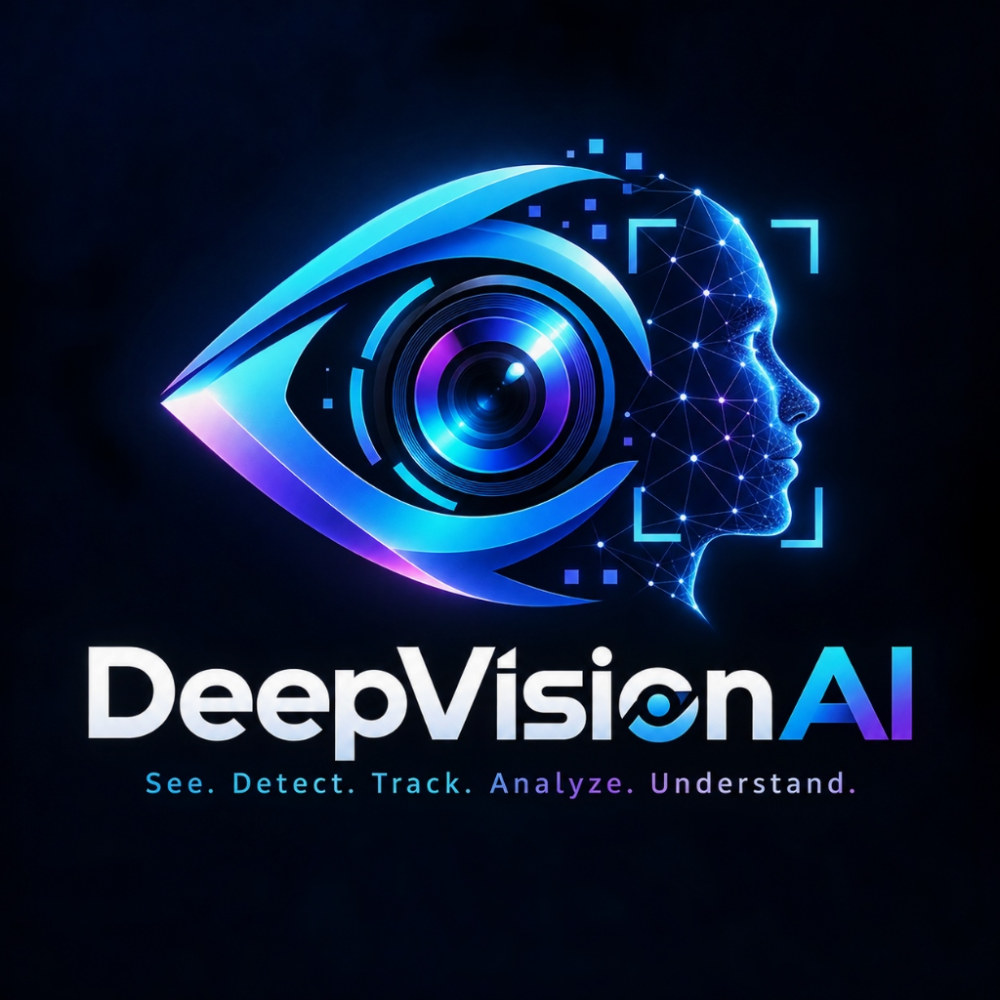

<div align="center">
  

  # 🛡️ DeepFaceGuard

  > **Industry-grade Deepfake Detection Platform** — Detect deepfakes in photos, videos & live webcam with AI

  
  
  
  
</div>

---

## ✨ Features

- 📸 **Photo Detection** — Upload any image, get deepfake analysis in < 500ms
- 🎥 **Video Analysis** — Frame-by-frame analysis with timeline heatmap
- 🔴 **Live Webcam** — Real-time deepfake detection via WebSocket stream
- 🧠 **AI Explainability** — GradCAM heatmaps showing suspicious regions
- 📊 **Signal Analysis** — Frequency, blur, color & compression artifact scores
- 🔐 **Auth System** — JWT-based registration & login
- 📜 **Detection History** — Full history of past detections
- 🌐 **REST API** — Full API access for programmatic use

---

## 🚀 Quick Start (2 steps)

### Option A: Manual (Recommended for development)

**Step 1 — Backend**
```bash
cd backend
python -m venv venv
venv\Scripts\activate          # Windows
pip install -r requirements.txt
python -m uvicorn main:app --reload --port 8000
```

**Step 2 — Frontend** (new terminal)
```bash
cd frontend
npm install
npm run dev
```

Open → **http://localhost:5173**

API docs → **http://localhost:8000/docs**

---

### Option B: One-click setup
```bash
# Double-click setup.bat
```

---

## 📁 Project Structure

```
DeepFaceGuard/
├── deepvision-ai/           # Production DeepVision AI microservice
│   ├── backend/             # FastAPI computer vision server
│   ├── models/              # Neural network weights (YuNet, ONNX)
│   ├── docs/                # Architecture & model selection docs
│   └── scripts/             # Development visualization utilities
│
├── backend/                 # Platform API & database server
├── frontend/                # React 18 + TypeScript + Vite UI
├── ml_engine/               # Multi-signal deepfake classification
└── docker-compose.yml       # Full stack Docker
```

---

## 🧠 DeepVision AI Face Detection Pipeline

Every detection request executes through a deterministic 9-stage pipeline:

```text
Image Upload
     ↓
Validation
     ↓
Preprocessing
     ↓
AI Inference
     ↓
Face Detection
     ↓
Confidence Filtering
     ↓
NMS / Postprocessing
     ↓
Bounding Box Validation
     ↓
Structured JSON Result
```

### 🌟 Current Capabilities
* **Real Image Face Detection**: Real neural network inference using YuNet ONNX weights (`face_detection_yunet_2023mar.onnx`).
* **Multiple Faces**: Accurately localizes and detects multiple human faces across varying scales, orientations, and crowded scenes in a single forward pass.
* **Facial Landmarks & 3D Head Pose**: 5-point canonical facial landmarks with sub-pixel regression and 3D Euler head orientation (Yaw, Pitch, Roll angles).
* **Multi-Face Video Tracking**: ByteTrack multi-object tracking associating bounding boxes across time with 8D constant-velocity Kalman filtering.
* **Temporary Track IDs**: Ephemeral, session-scoped integer IDs (`Track #1`, `Track #2`) denoting spatio-temporal continuity.
* **Optical Quality Analytics**: Granular face diagnostics including Laplacian blur variance, photopic luminance distribution, contrast, and composite usability grading.
* **Annotated Video Rendering**: Video composition rendering HUD cards with Track ID, confidence, optical scores, and session metrics into downloadable MP4 video containers.
* **Modern Web Interface**: Next.js 14 AI vision workspace featuring interactive canvas visualizers, dark/light themes, drag-and-drop media ingestion, and job telemetry.

### ⚠️ Privacy Guardrails & Planned Roadmap
* ❌ **Identity Recognition / Biometric Matching**: Strictly prohibited by design. No facial embeddings extraction, identity database matching, or biometric identification is active (`face_id: null`).
* ❌ **Live Webcam Streaming WebSocket**: Real-time webcam frame-by-frame streaming over WebSocket is planned for future phases.
* ❌ **Liveness & Anti-Spoofing Detection**: 2D/3D presentation attack and silicon mask anti-spoofing verification models belong to upcoming security roadmaps.

---

## 🔌 API Endpoints

| Method | Endpoint | Description |
|--------|----------|-------------|
| POST | `/api/v1/auth/register` | Create account |
| POST | `/api/v1/auth/login` | Get JWT token |
| GET | `/api/v1/auth/me` | Get current user |
| POST | `/api/v1/detect/image` | Detect deepfake in image |
| POST | `/api/v1/detect/video` | Queue video analysis |
| GET | `/api/v1/detect/status/{id}` | Poll job status |
| GET | `/api/v1/detect/result/{id}` | Get full result |
| WS | `/api/v1/detect/ws/stream` | Real-time webcam stream |
| GET | `/api/v1/history` | Get detection history |
| GET | `/api/v1/stats` | Usage statistics |
| GET | `/health` | Health check |
| GET | `/docs` | Swagger UI |

---

## 🧠 ML Detection Signals

| Signal | Weight | What it detects |
|--------|--------|-----------------|
| Frequency Analysis | 35% | GAN checkerboard artifacts in FFT |
| Blur Analysis | 20% | Unnaturally smooth skin (Laplacian) |
| Color Consistency | 20% | Paste boundary color mismatch |
| Compression Artifacts | 10% | Re-compression block artifacts |
| Neural Features | 15% | EfficientNet-B7 anomaly detection |

**Labels:** `REAL` (< 35%) | `SUSPICIOUS` (35-65%) | `DEEPFAKE` (> 65%)

---

## 🐳 Docker Deployment

```bash
docker-compose up --build
```

---

## ⚙️ Environment Variables

| Variable | Default | Description |
|----------|---------|-------------|
| `DATABASE_URL` | SQLite | Database connection string |
| `SECRET_KEY` | (required) | JWT signing key |
| `UPLOAD_DIR` | `./uploads` | File upload directory |
| `MAX_IMAGE_SIZE_MB` | 50 | Max image upload size |
| `MAX_VIDEO_SIZE_MB` | 500 | Max video upload size |

---

*Built with ❤️ for security professionals, researchers & journalists*
